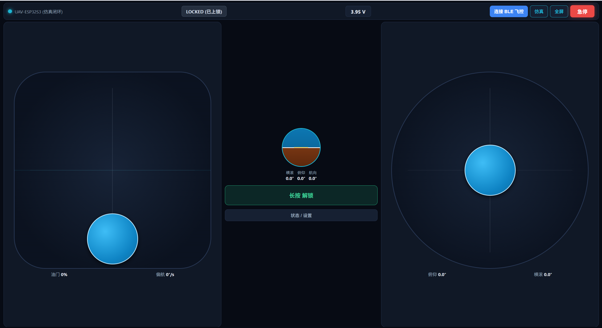
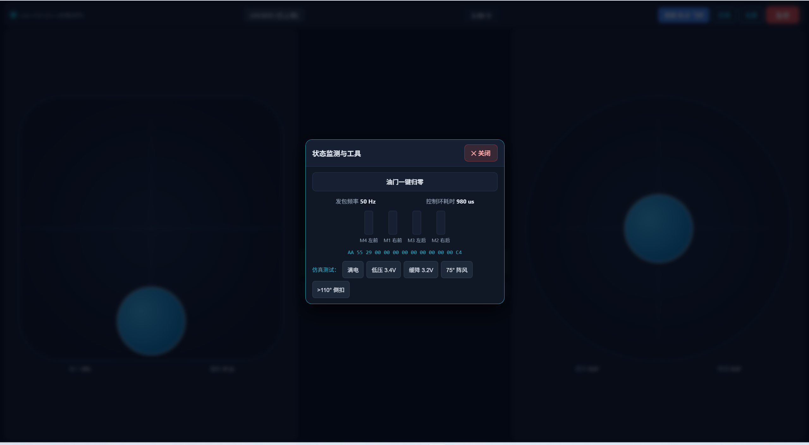

# 轻量无人机（ESP32 + 有刷 8520）

一个自制的微型四轴飞控学习项目：**板即机架**（嘉立创异形 PCB 当机架），
**ESP32-S3** 主控，**MPU6050 + QMC5883P**，**8520 空心杯**，**BLE 蓝牙低延迟手机/手柄控制**。

> 目标：**能姿态自稳、航向锁定、手动飞行、短时小范围悬停**（允许漂移）。
> 不追求高精度定点/定高，先把"能大致飞"跑通。

## 能力边界

| 能力 | 是否支持 |
|------|----------|
| 姿态自稳（不翻） | ✅ |
| 航向锁定（磁力计） | ✅ |
| BLE 手动飞行（10–20m，50Hz 低延迟） | ✅ |
| 短时小范围悬停（会缓慢漂移） | ✅ |
| 定高 / 定点 / 定距移动 | ❌（P8 扩展） |
| 抗风 / 自动航线 | ❌ |

## 硬件方案

| 部件 | 选型 |
|------|------|
| 主控 | ESP32-S3-N16R8 开发板（双核 240MHz，16MB/8MB，USB-C） |
| 姿态传感器 | MPU6050 GY-521（I²C） |
| 磁力计 | QMC5883P（I²C 0x2C） |
| 电机 | 8520 空心杯 ×4（1S） |
| 驱动 | AO3400（N-MOS）×4 + SS34 续流 ×4 |
| 电池 | 1S 3.7V 600mAh ≥25C |
| 电源 | 1S → MT3608 升 5V → ESP32；VBAT 分压进 ADC |
| 机架 | 嘉立创异形 PCB（100mm 对角轴距） |
| 控制 | ESP32-S3 BLE GATT（7.5–15ms 连接间隔）+ 跨平台手柄/地面站（Web Bluetooth / Gamepad / Capacitor App） |

**成本**：必购 ≈¥78（PCB 用打样券 ≈¥70）。

## 软件架构

- **ESP32-S3 + Arduino/ESP-IDF + FreeRTOS（双核）**
  - Core1：400Hz 实时控制（读 IMU → LPF → Mahony → 串级 PID → Quad-X → PWM）
  - Core0：BLE GATT 50Hz 控制下行 / 10–20Hz 遥测上行（`portMUX` 跨核零积压同步）、安全监控、状态灯
- **通信协议**：13B 下行控制帧（`0xAA 0x55`）+ 19B 上行遥测帧（`0x55 0xAA`），小端序紧凑二进制 + CRC-8 校验
- **算法**：二阶巴特沃斯 LPF（30–50Hz）+ Mahony 四元数 + 串级 PID + 保均值抗饱和 Quad-X 混控
- **输出**：LEDC 4× PWM，20kHz / 10bit
- **安全**：五态安全状态机（失联 500ms / 倾角 >60° 触发 Sticky Failsafe 锁死、3.5V 一级低压告警、3.3V 二级低压自动回平缓降、解锁四重联锁、电机总闸门 + 物理急停）

## 移动端触屏地面站界面

极简横屏双拇指 Web 地面站（支持 Android Chrome/Edge 浏览器、实体手柄接入与 1:1 离线飞控仿真器）：

| 主操控界面（人工地平仪 / 实时电压 / 双拇指摇杆） | 设置与仿真测试弹窗（原生 `<dialog>` / 零死区触控） |
|:---:|:---:|
|  |  |

## 目录结构

```
轻量无人机/
├── docs/                  # 文档与台账
│   ├── ARCHITECTURE.md    # 架构与算法
│   ├── DESIGN_FLOW.md     # 设计路径
│   ├── WORKPLAN.md        # 工作计划（工作项/验收/依赖）
│   ├── BOM.md             # 物料清单
│   └── ERRATA.md          # 代码审查纠错与验收台账
├── hardware/              # 板框 DXF 与生成脚本（v1–v8）
├── firmware/              # 机载固件（ESP32-S3 双核飞控、外设驱动、BLE 通信与 7 套 C 桌面单测）
│   ├── platformio.ini     # N16R8 编译与分区配置（锁定 espressif32@6.9.0）
│   ├── src/
│   │   ├── config.h       # 全板引脚、20kHz LEDC PWM、400kHz I²C 与采样周期配置
│   │   ├── main.cpp       # FreeRTOS 双核主入口（Core1 400Hz esp_timer 控制 + Core0 20Hz BLE/LED）
│   │   ├── drivers/       # 硬件驱动（mpu6050 / qmc5883p / motor_out / vbat / status_led）
│   │   ├── flight/        # 飞控算法（types / biquad_lpf / mahony / pid / mixer / safety / controller）
│   │   └── comm/          # BLE GATT 服务端与二进制协议（protocol.h / ble_server.*）
│   └── test/              # 桌面侧单元测试（7 套带强断言 CHECK() 的 C 测试）
└── controller/            # 移动端触屏地面站（Mode-2 1:1 相对位移双摇杆 + Gamepad + Web Bluetooth + 1:1 仿真器）
```

## 快速开始

> 前端地面站与离线仿真闭环已通过桌面自动化验收；机载固件源码与 C 单测已合拢，正在终端编译与无桨台架联调。

1. 阅读 `docs/ARCHITECTURE.md` 了解方案；
2. 按 `docs/BOM.md` 采购；
3. 按 `docs/WORKPLAN.md` 与 `docs/ERRATA.md` 逐项验收；
4. 运行地面站自检并启动本地/局域网手机调试服务（PowerShell）：
   ```powershell
   D:\Nodejs\node.exe controller/test/verify_protocol.mjs
   D:\Nodejs\node.exe controller/test/verify_controller.mjs
   D:\Nodejs\node.exe controller/dev_server.mjs
   ```

## 安全红线

- 非飞行测试**一律拆桨**；
- 首次飞行必须**系绳或单轴测试架**；
- 上电默认锁定，解锁后先低油门；
- failsafe 每次飞行前实测；
- 人与桨盘面保持距离。

## 当前进度

| 阶段 | 状态 |
|------|------|
| P0 选型/BOM | ✅ 完成 |
| P1 硬件 | 🟡 板框 v8 已有，**电机位待改配 φ8.6 8520 孔位** |
| P2 软件环境 | ✅ `platformio.ini`（N16R8 `espressif32@6.9.0`）、`config.h` 与全仓工程骨架就绪 |
| P3 驱动与通信 | 🟡 `mpu6050`、`qmc5883p`、`motor_out`、`vbat`、`status_led`（WS2812 五态/校准灯语）、`ble_server`、`protocol.h`（13B/19B + CRC-8）代码就绪；待终端 `pio run` 编译与上板台架实测 |
| P4 算法+单测 | 🟡 串级 PID 总控 `controller.h`（80Hz/40Hz LPF + Mahony + 200 拍开机静置标定 + 分级倾角救机 + 怠速连续映射 + 实测 `dt` 钳位）与 7 套 C 桌面单测已清理重编全绿；待 `pio` 编译与实机调参 |
| P5 双核编排 | 🟡 `main.cpp`（Core1 400Hz `esp_timer` 精准唤醒 + Core0 BLE/20Hz 遥测/状态灯）已落地；待 `pio run` 编译烧录实测 |
| P6 调试与地面站 | ✅ 极简横屏双拇指触屏地面站（相对位移 1:1 摇杆、0.6s 长按解锁、原生 `<dialog>` 弹窗、E-04 切后台/断连强制归零、物理手柄增量/直映防暴冲、1:1 离线飞控仿真器）已通过全链路 Node 单测；待实机联调调参 |
| P7–P9 | ⬜ 未开始 |

详见 `docs/WORKPLAN.md` 与 `docs/ERRATA.md`。
