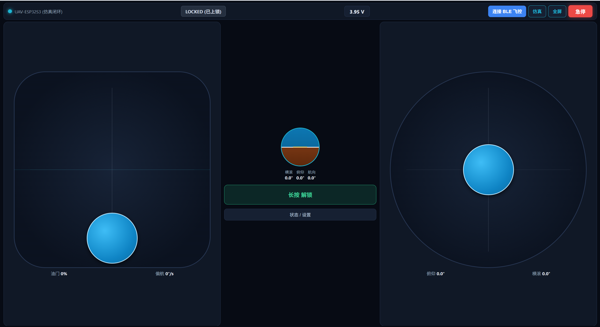
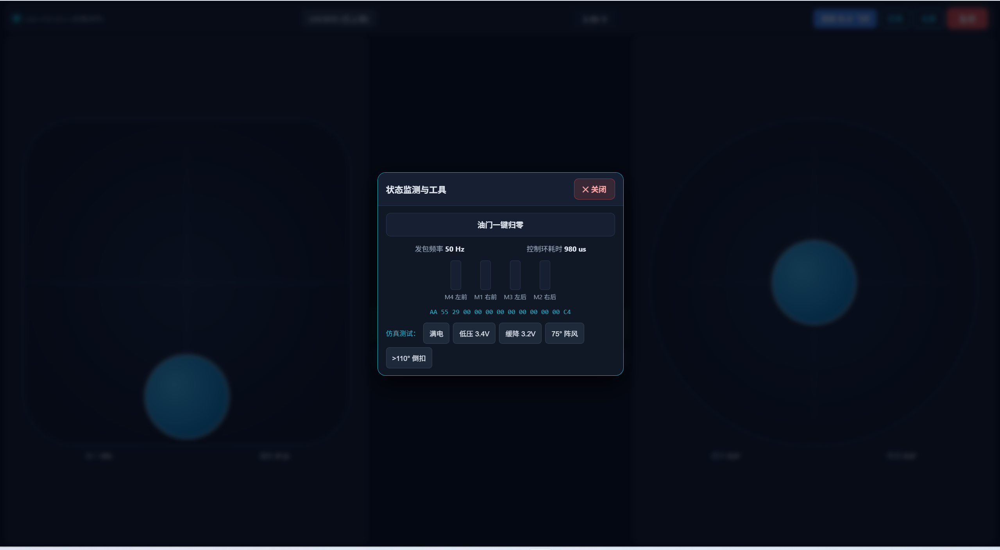

# UAV-ESP32S3 跨平台低延迟蓝牙手柄与地面站 (`controller/`)

与机载通信模块 [`firmware/src/comm/protocol.h`](../firmware/src/comm/protocol.h) 严格字节级对齐的前端与移动端遥控工程（**Web Bluetooth API + Web Gamepad API + Capacitor 原生壳**）。

| 主操控界面（人工地平仪 / 实时电压 / 双拇指触控摇杆） | 设置与仿真测试弹窗（原生 `<dialog>` / 极简操作） |
|:---:|:---:|
|  |  |

---

## 1. 核心架构与低延迟特性

1. **13 字节紧凑二进制下行帧 (`0xAA 0x55`) + 19 字节遥测上行帧 (`0x55 0xAA`)**：
   - 全程小端序 (`Little-Endian`) 二进制 `DataView` 打包，带 `CRC-8 (poly=0x07)` 校验；
   - 单包低于 BLE 默认 20 字节 ATT 载荷上限，无需分包。
2. **输入采样与 50Hz 蓝牙发包解耦（零队列积压）**：
   - 触屏 `PointerEvents` 与实体手柄 `Gamepad API` 仅更新内存变量；
   - 独立 `20ms (50Hz)` 定时器使用 `Write Without Response` 发送最新帧，若上一帧尚未完成则自动跳过，杜绝蓝牙缓冲区积压粘滞。
3. **美国手 Mode 2 + 飞控级摇杆曲线 + 五重安全联锁**：
   - **左摇杆**：油门纵向松手**不回中**（独立矩形行程，打偏航不掉油门）+ 偏航横向回中；
   - **右摇杆**：俯仰/横滚双向松手回中，内置 **4% 中心死区 + 0.35 三次方 Expo 曲线**（精简界面，无多余微调/舵量切换按钮）；
   - **安全护栏**：油门 `> 5%` 禁止解锁联锁、全屏醒目红色 `KILL 急停` 按钮（连发 3 帧硬件级强制锁死包）、切后台/锁屏自动归零回中。
4. **内置离线飞控仿真闭环 (`Simulator`)**：
   - 在未连接实物飞控板时，页面自动运行与 [`safety.h`](../firmware/src/flight/safety.h) 和 [`mixer.h`](../firmware/src/flight/mixer.h) 完全一致的仿真闭环，可直接在界面演练解锁联锁、`<3.5V` 低压告警、`<3.3V` 强制缓降与 `>60°` 翻机锁死复位。

---

## 2. 手机使用须知（横屏双拇指）

- **横屏使用**：竖屏会显示“请横屏”遮罩；点顶栏 `全屏` 可全屏并锁定横屏（Android Chrome）。
- **摇杆手感**：整个半屏都是触控区，拇指落哪都行；**落指处即原点**，手指落下油门/姿态不会跳变，只有拖动才改变。左摇杆油门松手保持，偏航回中；右摇杆松手回中。
- **防误触**：`解锁/上锁` 需**长按 0.6 秒**（带进度条）；紧急情况单击红色 `急停`。
- **安全联动**：操控期间自动保持屏幕常亮（Wake Lock）；来电/下拉通知栏/切后台/锁屏会自动上锁并发急停帧；故障、迫降、低压时手机振动（Android）。
- **蓝牙环境（重要）**：Web Bluetooth 只在 **HTTPS 或 `localhost`** 下可用，且仅 **Android Chrome / Edge** 支持：
  - 用电脑局域网 IP（`http://192.168.x.x:5173`）打开 **无法** 使用蓝牙；
  - 方案 A：USB 调试 + `adb reverse tcp:5173 tcp:5173`，手机访问 `http://localhost:5173`；
  - 方案 B：部署到任意 HTTPS 静态站点（如 GitHub Pages / Netlify），手机直接访问；
  - 方案 C：`npm run build` 后用 Capacitor 打包 Android / iOS 原生 App（iPhone 只能走此方案）。

---

## 3. 快速运行指南

### 方式 A：零依赖极速启动（立即可用，无需等待 `npm install`）

项目内置了基于 Node.js 原生 TypeScript 编译器的开发服务器，直接在项目根目录执行：

```bash
# 1. 运行协议与摇杆数学自检单测
node controller/test/verify_protocol.mjs

# 2. 启动地面站与手柄 Web 服务 (http://localhost:5173)
node controller/dev_server.mjs
```

随后用电脑或安卓手机的 **Chrome / Edge 浏览器** 打开 `http://localhost:5173`（手机与电脑同局域网时可访问电脑局域网 IP）。

### 方式 B：标准 Vite 开发与 Capacitor 原生 App 打包（Android / iOS）

```bash
cd controller
npm install

# 启动 Vite 热重载开发服务器
npm run dev

# 构建生产包并同步至 Android / iOS 原生工程
npm run build
npx cap add android
npx cap sync
npx cap open android
```
